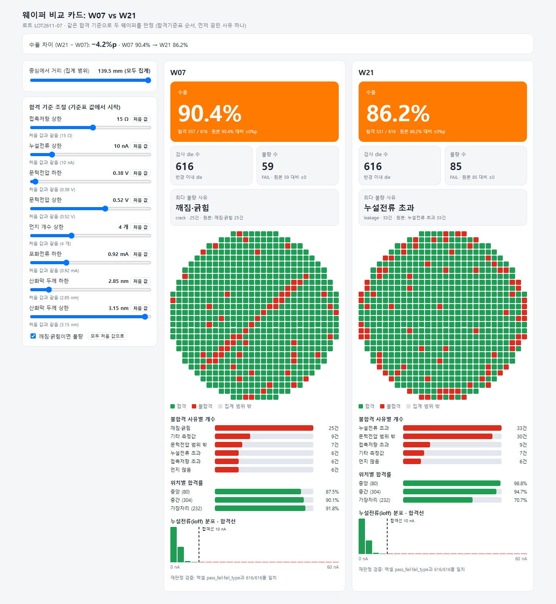

# 웨이퍼 비교 시뮬레이터 (W07 vs W21)

같은 합격 기준으로 두 웨이퍼(로트 `LOT2611-07`, 각 616 die)를 판정해 나란히 보여 주는 화면입니다.

**▶ 결과 화면 열기: https://qkrwogh722-star.github.io/sim-labs-workspace/simulator_compare.html**

GitHub 저장소 화면에서는 HTML이 실행되지 않고 코드만 보입니다. 결과는 위 링크나 아래 캡처로 확인하세요.

## 결과 (합격기준표 기본값)

| | W07 | W21 |
|---|---|---|
| 수율 | **90.4%** (557/616) | **86.2%** (531/616) |
| 불량 수 | 59 | 85 |
| 최다 불량 사유 | 깨짐·긁힘 25건 | 누설전류 초과 33건 |
| 위치별 합격률 (중앙 / 중간 / 가장자리) | 87.5% / 90.1% / 91.8% | 98.8% / 94.7% / 70.7% |
| 엑셀 판정과 일치 | 616/616 | 616/616 |

수율 차이(W21 − W07)는 −4.2%p입니다.

### 불합격 사유별 개수

| 사유 | W07 | W21 |
|---|---|---|
| 깨짐·긁힘 (crack) | 25 | 0 |
| 접촉저항 초과 (open_short) | 6 | 9 |
| 누설전류 초과 (leakage) | 6 | 33 |
| 문턱전압 범위 밖 (vth_shift) | 7 | 30 |
| 먼지 많음 (particle) | 6 | 6 |
| 기타 측정값 (parametric) | 9 | 7 |

## 판정 방식

합격기준표 순서대로 확인해 **처음 걸린 사유 하나**로 판정합니다(걸리는 게 없으면 합격). 접촉저항 15 Ω 이하, 누설전류 10 nA 이하, 문턱전압 0.38~0.52 V, 먼지 4개 이하, 포화전류 0.92 mA 이상, 산화막 두께 2.85~3.15 nm 범위이며, 화면의 조절 바로 기준을 바꿔 다시 계산할 수 있습니다.

## 파일

- `simulator_compare.html`: 데이터가 들어 있는 단일 HTML (인터넷 연결 없이 열림)
- `index.html`: 위 화면으로 이동하는 안내 페이지
- `screenshot.png`: 기본값 화면 캡처
